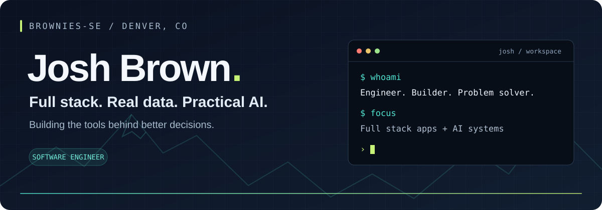
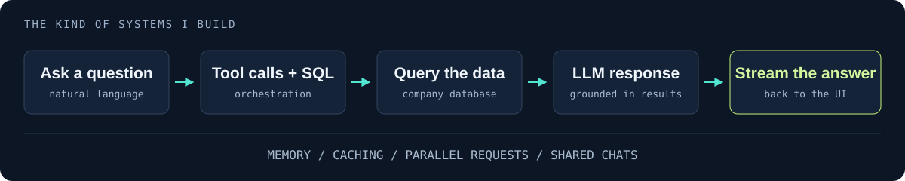

  

I’m **Josh**, a software engineer in Denver. I build full stack applications and AI tools that help people work with complex information—from software security to insurance underwriting.

### `01 / What I build`

**AI that works with real data.** At **Insurate**, I build tools for underwriters: web research, account insights, and an internal assistant that turns questions into SQL, retrieves company data, and streams answers grounded in the results.

  

The work spans conversational memory, shared chats, caching, parallel AI requests, and integrations with **OpenAI and Anthropic SDKs**. I also built a dedicated testing portal connected to a development environment so AI tools can be tested without touching live data.

**Full stack foundations.** Previously at **Fortress Information Security**, I built APIs and applications with Node.js, Python, PostgreSQL, React, and Express. I maintained an internal portal integrating VirusTotal APIs to support analysis of new software releases.

### `02 / The toolkit`

| Build | Connect | Ship |
| :--- | :--- | :--- |
| JavaScript · Python | OpenAI · Anthropic SDKs | React · Node.js · Express |
| PostgreSQL · SQL | Tool calling · Memory · Streaming | APIs · Caching · AI test environments |

**In my editor & terminal:** Claude · Codex · Cursor · Grok CLI

### `03 / Earlier builds`

[**ClayPal ↗**](https://github.com/TJCourey/ClayPal) — A collaborative score-tracking app for clay sports, with dashboards and leaderboards.

[**Insomnia-Thai ↗**](https://github.com/Brownies-SE/Insomnia-Thai) — A collaborative restaurant app with accounts, reservations, takeout orders, and email confirmations.
